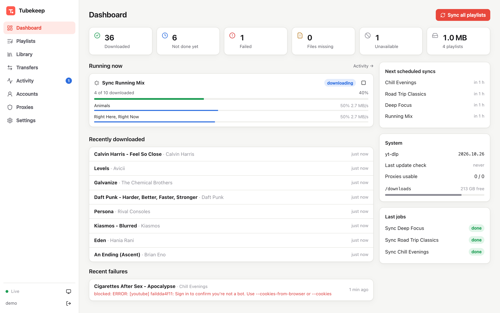
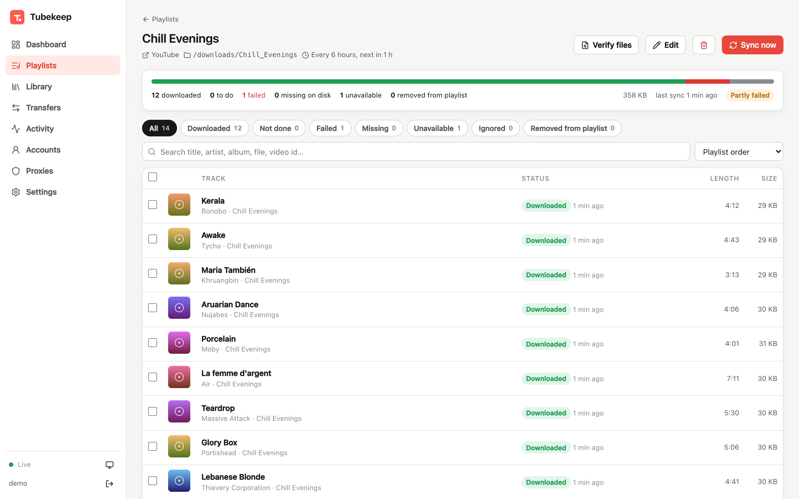
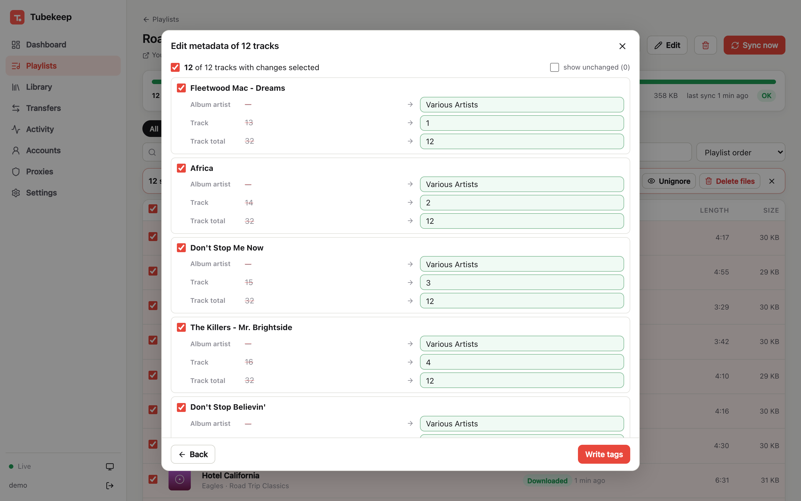
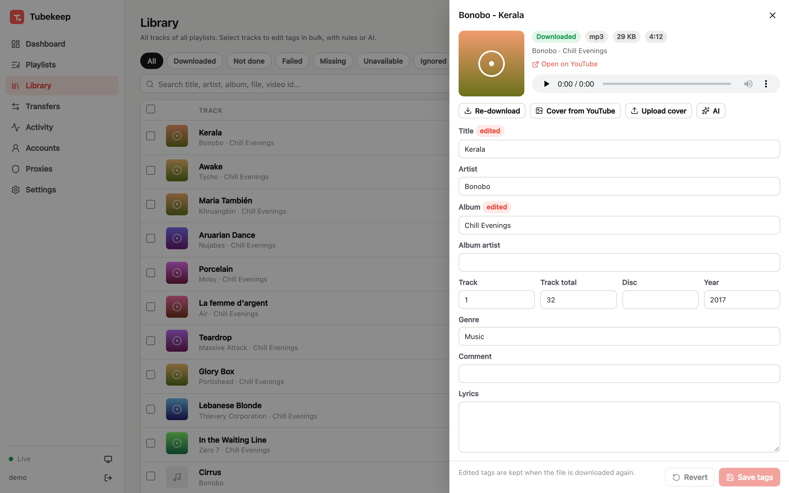
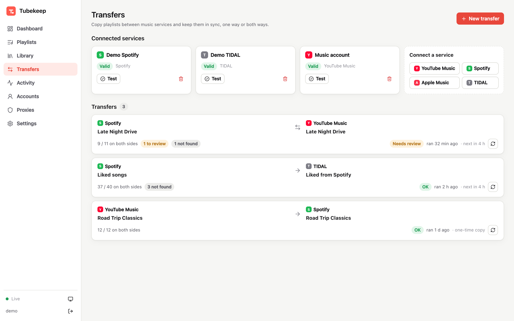
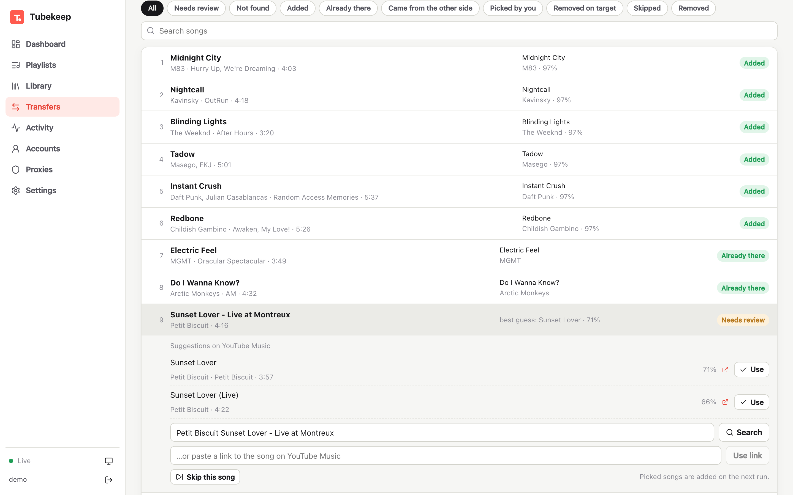
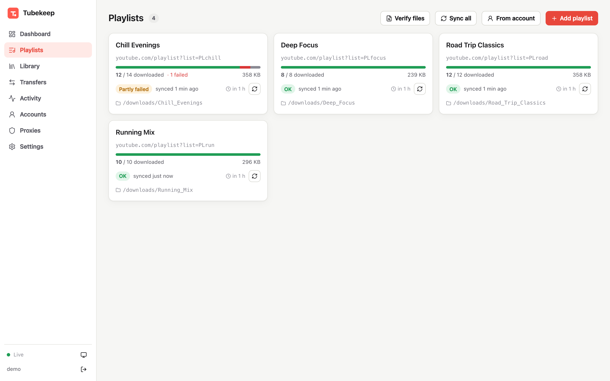
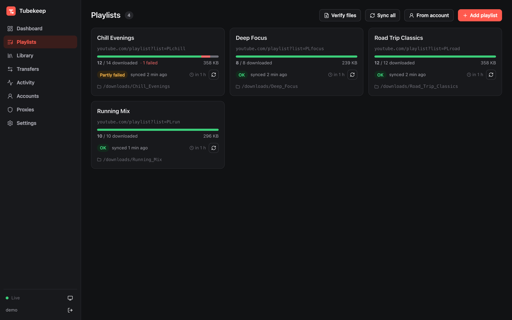
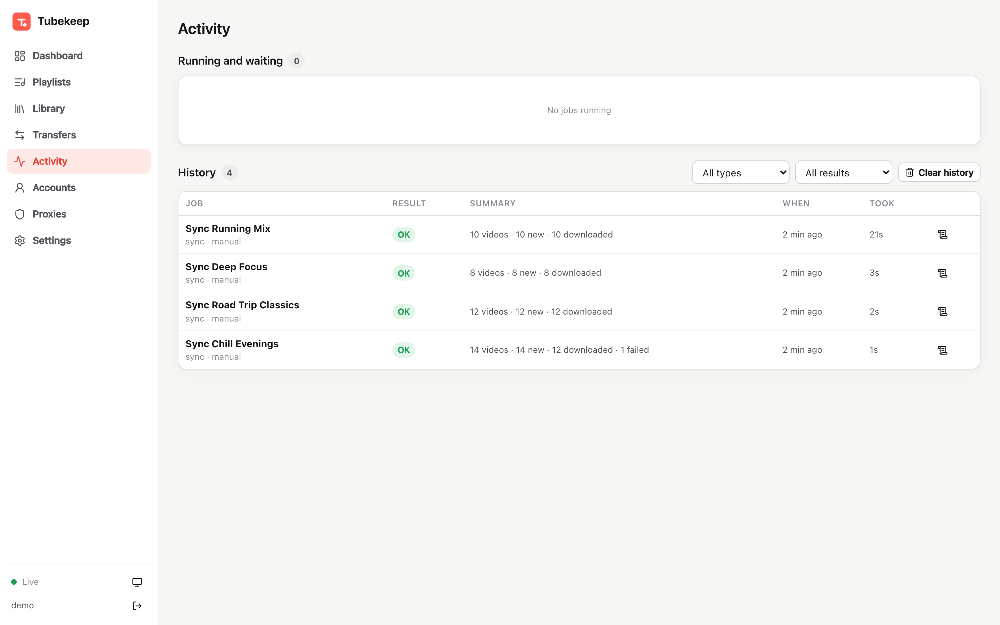

<div align="center">


# Tubekeep

**Keep your YouTube playlists on your own disk, as tagged audio files, and move playlists between YouTube Music, Spotify, Apple Music and TIDAL.**

[](https://github.com/eliasthecactus/tubekeep/actions/workflows/ci.yml)
[](https://github.com/eliasthecactus/tubekeep/pkgs/container/tubekeep)
[](LICENSE)
[](#built-with-claude)



</div>

> [!NOTE]
> **Built with Claude.** This project was written to a large extent by [Claude](https://claude.ai) (Anthropic's AI) through Claude Code, steered, tested and reviewed by me. See [Built with Claude](#built-with-claude) for what that means for you.

---

## What it does

Tubekeep is a self-hosted web app around [yt-dlp](https://github.com/yt-dlp/yt-dlp). You add playlists, it keeps them downloaded as mp3/m4a/opus/flac with cover art and tags, and it shows you exactly what is done, what failed and why. On top of that it can copy playlists between music services and keep them in sync.

One container, SQLite, no external services needed.

### Playlists and downloads

- **Add playlists by URL**, paste a whole list at once, or pick them from a signed-in YouTube account.
- **Per playlist settings**: download folder (any mounted path), schedule (cron), account, proxy, audio format, file name template.
- **Status for every track**: downloaded, not done, failed (with the yt-dlp error), unavailable, missing on disk, removed from the playlist, ignored. Removed tracks only show under their own filter: without a file they are forgotten automatically, with a file you can forget them (and delete the file if you want).
- **Missing files are detected**: every sync compares the database with the disk. Deleted files are downloaded again even when they are marked as done, moved or renamed files are found again by the video id stored in their tags, and existing files in a folder are picked up instead of downloaded twice.
- **Unmounted drives are noticed**: every playlist folder gets a small hidden `.tubekeep` file. If it's gone (for example the drive isn't mounted), Tubekeep doesn't treat the files as deleted: syncs of that playlist pause and the dashboard asks how to continue (check again, download everything again, or keep the files as missing). Once the folder is back, syncing continues by itself.
- **Live activity**: progress, speed and stage per track, job history and the full log of every job.
- **Clean up the YouTube playlist itself**: on playlists the linked account can edit (its own or collaborative ones), select tracks, in one playlist or across many in the Library, and remove them from the real YouTube playlist, optionally with their files. Tubekeep asks first, because this can't be undone from here.
- **Alternatives for dead videos**: select tracks and let Tubekeep search YouTube Music for a working version, ranked by how well title, artist and length match. Add it next to the old entry or replace the old one in place. Tubekeep uses the title it remembered, the file tags or the greyed-out YouTube Music entry; if none of them exist, type your own search. Tubekeep checks the playlist afterwards and only updates its own list once YouTube really shows the change. A sync never marks a track as removed while YouTube Music still has it, so a youtube.com listing that is behind can't throw out a new track.
- **Duplicates**: a page lists tracks you have more than once: the same video in several playlists, the same song as different videos (official video and audio upload, matched by title, artist and length; live, remix or cover versions don't count) and videos added twice to one YouTube playlist. Keep one copy and remove the others from YouTube, delete only their files, or let Tubekeep ignore them, per group or for many groups at once. A file another copy still uses is never deleted.
- **Queue**: start as many playlists as you like; a few sync at the same time (Settings → "Playlists synced at the same time"), the rest wait their turn and survive a restart.

<p align="center"></p>

### Private playlists, proxies, fresh yt-dlp

- **YouTube accounts via cookies** for private playlists, Liked videos and Watch later. Cookies are stored encrypted, refreshed cookies are saved back after every run and accounts are checked regularly.
- **Proxy pool** (http, https, socks4/5) with round robin or random selection. A proxy that gets rate limited or hits the bot check cools down and the next one takes over. Accounts stick to one proxy so the session keeps its IP.
- **yt-dlp updates itself**: the image ships a copy, the container keeps its own copy in the config volume and checks GitHub in the background (stable or nightly). New versions are installed next to the running one, so active downloads are never interrupted.

### Metadata editor

- Edit every tag and the cover of a track, with an audio preview.
- **Bulk rules** with a preview diff before anything is written: split "Artist - Title", find and replace (regex), remove "(Official Video)" and friends, change case, number tracks, copy fields, rename files.
- **AI suggestions through [OpenRouter](https://openrouter.ai)**: describe what you want ("split artist and title, use the real album and year") and review every change before it is saved.
- Tags you edit are kept when a file is downloaded again.

<p align="center"></p>
<p align="center"></p>

### Transfers between music services

Copy a playlist from one service to another, once or continuously:

- **YouTube Music, Spotify, Apple Music, TIDAL**, in any direction (also between two accounts of the same service).
- **Keep in sync** on a schedule, **one way or both ways**, with optional **removal sync**.
- **Matching** by ISRC where the service supports it, otherwise by search and a score over title, artists, duration and version (live, remix, acoustic …).
- **Review screen** for uncertain or missing songs: pick a suggestion, search yourself, paste a link or skip.
- Liked songs work as a playlist on every service.
- Optional: download the YouTube side of a transfer with Tubekeep, so a Spotify playlist ends up as files on your disk.

<p align="center"></p>
<p align="center"></p>

<details>
<summary>More screenshots</summary>

<p align="center"></p>
<p align="center"></p>
<p align="center"></p>

</details>

---

## Quick start

```yaml
services:
  tubekeep:
    image: ghcr.io/eliasthecactus/tubekeep:latest
    container_name: tubekeep
    restart: unless-stopped
    ports:
      - "8080:8080"
    environment:
      - PUID=1000
      - PGID=1000
      - TZ=Etc/UTC
      - ADMIN_USER=admin
      - ADMIN_PASSWORD=change-me-please
    volumes:
      - ./tubekeep/config:/config
      - ./tubekeep/downloads:/downloads
      # more folders a playlist can download to:
      # - /path/to/music:/music
```

```sh
docker compose up -d
```

Open `http://<server>:8080` and sign in. Without `ADMIN_USER`/`ADMIN_PASSWORD`, the first visit asks you to create an account.

Images are built for `linux/amd64` and `linux/arm64`. Tags: `latest` (last release), `x.y.z`, `x.y`, `edge` (main branch).

### Volumes

| Path | Content |
| --- | --- |
| `/config` | database, encryption key, yt-dlp, job logs, caches. Back this up. |
| `/downloads` | default root, every playlist gets `/downloads/<Playlist_Name>` |
| anything else | mount more folders and choose them per playlist in the UI |

### Environment variables

| Variable | Default | |
| --- | --- | --- |
| `PUID` / `PGID` | `1000` | user and group the app runs as; files are created with them |
| `ADMIN_USER` / `ADMIN_PASSWORD` | | creates the first account on the first start |
| `APP_SECRET` | random, stored in `/config/secret.key` | key that encrypts cookies, tokens and API keys |
| `SESSION_DAYS` | `30` | how long a login lasts |
| `FORWARDED_ALLOW_IPS` | `*` | which reverse proxies may set `X-Forwarded-*` headers |
| `TZ` | `UTC` | time zone for schedules |

### Behind a reverse proxy

Tubekeep speaks plain HTTP. Live updates use Server-Sent Events, so response buffering has to be off for `/api/events`:

```nginx
location / {
    proxy_pass http://tubekeep:8080;
    proxy_set_header Host $host;
    proxy_set_header X-Forwarded-For $proxy_add_x_forwarded_for;
    proxy_set_header X-Forwarded-Proto $scheme;
    client_max_body_size 20m;
}
location /api/events {
    proxy_pass http://tubekeep:8080;
    proxy_set_header Host $host;
    proxy_set_header X-Forwarded-Proto $scheme;
    proxy_buffering off;
    proxy_read_timeout 1h;
}
```

The app also sends `X-Accel-Buffering: no`, so Nginx Proxy Manager usually works with a default proxy host.

---

## Guides

<details>
<summary><b>Moving over from a yt-dlp script</b></summary>

If you already download playlists with a script into `downloads/<Playlist_Name>/<channel> - <title>.mp3`:

1. Mount the existing download folder at `/downloads`.
2. Playlists → Add playlist → paste all playlist URLs (one per line, a `playlists.txt` works as is).
3. Folder names are built like `tr -cd '[:alnum:] _-' | sed 's/ /_/g'`, so every playlist lands in its existing folder. The first sync links the files that are already there and only downloads what is missing.

The default settings match a typical script: mp3, best quality, embedded cover and metadata, file name `%(channel)s - %(title)s`.

</details>

<details>
<summary><b>Private playlists (YouTube accounts)</b></summary>

1. Open a private/incognito window and sign in to YouTube. A secondary Google account is safer, heavy downloading can get an account flagged.
2. Export the cookies in Netscape format, for example with the *Get cookies.txt LOCALLY* extension.
3. Close the private window right away. YouTube rotates the cookies of open sessions, which makes the export invalid.
4. Accounts → Add account → paste the file, then assign the account to the playlists that need it.

Unlisted playlists work without an account.

</details>

<details>
<summary><b>Connecting music services for transfers</b></summary>

| Service | How | Notes |
| --- | --- | --- |
| **YouTube Music** | uses a YouTube account from the Accounts page | via [ytmusicapi](https://github.com/sigma67/ytmusicapi) |
| **Spotify** | create an app on [developer.spotify.com](https://developer.spotify.com/dashboard), add the redirect URI shown in Tubekeep, paste the Client ID | PKCE, no secret needed. Development apps require the app owner to have Premium and are limited to users you add to the app. Use `127.0.0.1` instead of `localhost` for local tests, or set the public URL behind a proxy. |
| **Apple Music** | a MusicKit key from your Apple Developer account (Team ID, Key ID, `.p8`), then sign in with your Apple ID | the Apple Music API can add songs to playlists but not remove them; such removals are listed instead |
| **TIDAL** | device login: open the link, confirm the code | via [tidalapi](https://github.com/tamland/python-tidal), unofficial |

How sync works:

- Songs added on the source are added to the target (and the other way round with "both directions").
- With "sync removals", songs removed since the last run are removed on the other side.
- A song you removed from the target yourself is never added again.
- Matches are cached, so later runs only search for new songs.

</details>

<details>
<summary><b>AI metadata</b></summary>

Add an [OpenRouter](https://openrouter.ai) API key in Settings and pick a model (cheap and fast models work well, the default is `anthropic/claude-haiku-5.5`). Select tracks → AI tags → describe what to fix. Tubekeep sends the YouTube title, channel, a short description excerpt and the current tags, and shows the suggestions as a diff you can edit before writing.

</details>

---

## Development

```sh
# backend (Python 3.12+; ffmpeg and deno in PATH for real downloads)
cd backend
python -m venv .venv && .venv/bin/pip install -r requirements-dev.txt
CONFIG_DIR=../data/config DOWNLOADS_DIR=../data/downloads .venv/bin/uvicorn app.main:app --port 8765 --reload
.venv/bin/pytest          # runs offline with a fake yt-dlp and fake music services

# frontend (dev server proxies /api to :8765)
cd frontend
npm install && npm run dev
```

API docs are served at `/api/docs`.

**Stack:** FastAPI, SQLite, yt-dlp, ffmpeg, deno, mutagen, rapidfuzz, ytmusicapi, tidalapi · SvelteKit (static SPA) · one Docker image.

```
backend/app/
  jobs.py         job engine: sync, downloads, file verification
  ytdlp.py        yt-dlp install, background updates, process handling
  library.py      folders, scanning and matching files on disk
  tags.py         reading/writing tags and covers
  metadata_ops.py bulk rules, ai.py OpenRouter suggestions
  providers/      YouTube Music, Spotify, Apple Music, TIDAL
  matching.py     finding the same song on another service
  transfers.py    playlist transfer and sync
frontend/src/     SvelteKit pages and components
```

Issues and pull requests are welcome.

## Built with Claude

Most of the code, the tests and this README were written by **Claude**, Anthropic's AI model, working in Claude Code. I described what I wanted, made the decisions, tested it on my own server and reviewed the result. I'm saying this openly so you can judge the project with that in mind: the code has tests and runs in my setup, but it has not been written line by line by a human. If you find something odd, please open an issue.

## Legal

Tubekeep is a tool for personal use. Download only content you are allowed to download and respect the terms of the services you use. The project is not affiliated with YouTube, Google, Spotify, Apple or TIDAL.

## License

[MIT](LICENSE)
